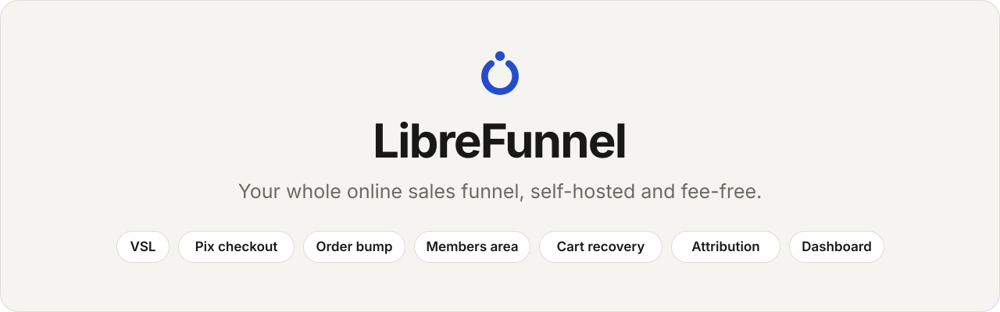

<p align="center">
  <picture>
    <source media="(prefers-color-scheme: dark)" srcset="docs/banner-dark.svg">
    
  </picture>
</p>

<p align="center">
  <a href="https://github.com/ToledoSDL/librefunnel/actions/workflows/ci.yml"></a>
  <a href="LICENSE"></a>
  
</p>

# LibreFunnel

A free, self-hosted sales funnel for Brazilian infoproduct sellers: sales page, Pix checkout, members area, recovery and analytics in one app.

## Why

Selling a course online usually means paying monthly for a page builder, a checkout, a members area, a cart recovery tool and an attribution tracker, plus a fee on every sale. LibreFunnel does all of it in one app that runs on a free server. Pix goes straight to your own key, so there is no fee unless you turn on automatic confirmation.

## Features

- **Sales page (VSL)**: video with the buy button revealed at the second you choose, offer deadline, guarantee, testimonials and FAQ.
- **Pix checkout**: paid straight to your Pix key at zero fees, or confirmed automatically through Mercado Pago (0.99% per sale, CPF or CNPJ), Woovi or AbacatePay (from R$ 0.80 per Pix, CNPJ only).
- **Order bump**: an extra product offered on the checkout.
- **Members area**: modules, lessons and progress. Buyers sign in with a magic link sent by e-mail, no passwords.
- **Abandoned checkout recovery**: by e-mail (any SMTP, such as a free Gmail app password) and by WhatsApp (self-hosted Evolution API, optional). It stops when the buyer pays or opts out, and WhatsApp messages never go out between 21:00 and 09:00.
- **WhatsApp auto-replies**: keyword answers, with opt-out when the buyer replies `SAIR`.
- **Attribution**: UTMs with first and last touch, and sales sent to Meta through the Conversions API.
- **Admin dashboard**: revenue, funnel, sources, orders with release and refund, messages, connections and CSV export. Products, course content, automations, e-mail, Pix providers and Meta are set up there too, each connection with a **Testar** button, and changes apply instantly.

## Quick start

You need a Linux server with a public IP and ports 80 and 443 open. The free [Oracle Cloud Always Free](https://www.oracle.com/cloud/free/) tier works well. The [deployment guide](docs/deploy.md) walks through every click, from creating the server to the first sale.

1. **Point a hostname at your server.** Use a free [DuckDNS](https://www.duckdns.org) name (`yourstore.duckdns.org`) or an `A` record on your own domain.
2. **Connect to the server and install Docker.**

   ```sh
   ssh -i your-key.key ubuntu@YOUR_SERVER_IP
   curl -fsSL https://get.docker.com | sudo sh
   sudo usermod -aG docker $USER && exit
   ```

   On Oracle Cloud, also open the server's own firewall: `sudo iptables -I INPUT -p tcp -m multiport --dports 80,443 -j ACCEPT && sudo netfilter-persistent save`.

3. **Download LibreFunnel.** Reconnect with `ssh`, then:

   ```sh
   git clone https://github.com/ToledoSDL/librefunnel.git
   cd librefunnel
   cp .env.example .env
   ```

4. **Fill in `.env`.** Open it with `nano .env` and set at least `BASE_URL`, `DOMAIN`, `ADMIN_PASSWORD`, `SECRET` and `POSTGRES_PASSWORD` (see [Configuration](#configuration)).
5. **Start it.**

   ```sh
   docker compose up -d --build
   ```

6. **Open `https://yourstore.duckdns.org/admin`** and sign in with `ADMIN_PASSWORD`. Caddy issues the HTTPS certificate on its own. A demo product is already there: set your Pix key, price and lessons in the Products tab, then set up e-mail in **Conexões** so buyers receive their access link.

## Configuration

Server settings live in `.env`. Each line in [`.env.example`](.env.example) explains itself. The minimum to sell:

| Variable            | What it is                                                                                                                                |
| ------------------- | ----------------------------------------------------------------------------------------------------------------------------------------- |
| `BASE_URL`          | Public address of the store, such as `https://yourstore.duckdns.org` (no trailing slash).                                                 |
| `DOMAIN`            | The same hostname without `https://`. Caddy uses it to get the certificate.                                                               |
| `ADMIN_PASSWORD`    | Dashboard password, at least 16 characters. Generate with `openssl rand -base64 24`.                                                      |
| `SECRET`            | Signs cookies and access links and encrypts the keys saved in **Conexões**, at least 32 characters. Generate with `openssl rand -hex 32`. |
| `POSTGRES_PASSWORD` | Password of the PostgreSQL database that runs next to the app. Generate with `openssl rand -hex 24`.                                      |

Optional: `EVOLUTION_KEY` for the WhatsApp server bundled with the app. The app refuses to start when a required value is missing and says which one in `docker compose logs app`.

After editing `.env`, apply it with:

```sh
docker compose up -d
```

Everything else is managed in `/admin`, with no restart:

- **Products**: name, price, Pix key, offer deadline, guarantee, order bump, sales video, FAQ, testimonials, modules and lessons with video and cover uploads.
- **Automations**: recovery steps (channel, delay and text) and WhatsApp keyword replies.
- **Settings**: brand, your own e-mail and WhatsApp for sale notices, terms URL and how long a Pix order stays valid.
- **Conexões**: e-mail (Gmail, Brevo, Mailjet or any SMTP), Pix provider, generic payment webhook, Meta Conversions API and WhatsApp. Passwords and keys are stored encrypted and never shown again; **Testar** checks each one. Without e-mail, buyers pay and receive nothing.

## How Pix confirmation works

**Manual mode (free, the default).** The buyer pays straight to your Pix key. Open your **bank statement**, find a Pix with the order amount and identifier, then click **Release** on the order in `/admin`. Never release based on a screenshot sent by the buyer: receipts are easy to fake. Release sends the access link right away.

**Automatic mode (Mercado Pago, Woovi or AbacatePay).** In **Conexões** > **Recebimento do Pix**, paste the provider's keys, click **Salvar e usar este provedor** and register the webhook URL shown there in the provider's dashboard. Each order gets its own Pix from the provider; the webhook only makes the store ask the provider again, and access is released when the amount received covers the order. Refunds, chargebacks and lost MED claims revoke it. Orders keep the provider that issued them when you switch. See [the guide](docs/deploy.md#pix-providers-automatic-confirmation).

## Development

Requires [Bun](https://bun.sh) and Node.js 24.

```sh
bun install
cp .env.example .env   # set BASE_URL=http://localhost:3000, DATA_DIR=data, SECRET and ADMIN_PASSWORD
bun run dev            # http://localhost:3000
```

Without `DATABASE_URL`, development and tests run on [PGlite](https://pglite.dev), PostgreSQL compiled to WebAssembly: the dev database lives in `DATA_DIR/pglite` and tests use one in memory, so no Docker or database server is needed. Migrations apply on startup. After changing `src/lib/schema.ts`, run `bun run migration` to write the next migration.

Before opening a pull request, run the same checks as CI:

```sh
bun run check
```

Stack: Next.js 16 (App Router, standalone output), React 19, PostgreSQL with Drizzle ORM, nodemailer, Docker Compose and Caddy. Business rules live in `src/lib`, pages in `src/app`. See [CONTRIBUTING.md](CONTRIBUTING.md).

## License

[MIT](LICENSE)
